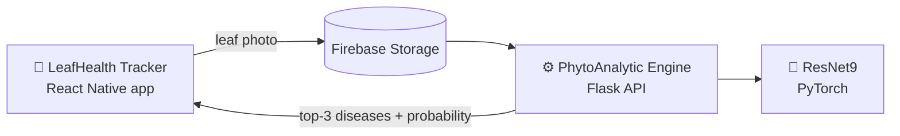

# PhytoAnalytic Engine 🌿

REST API that identifies **plant leaf diseases from a photo** using a **ResNet9** convolutional
neural network built with **PyTorch**. It is the backend of
[LeafHealth Tracker](https://github.com/CuencaOscar/LeafHealth-Tracker), the mobile app developed for my
**Master's thesis in Web Applications and Services Development** at Universidad Internacional de Valencia (VIU).


<p align="center"></p>
<p align="center"><sub>The <a href="https://github.com/CuencaOscar/LeafHealth-Tracker">LeafHealth Tracker</a> mobile app, powered by this API.</sub></p>

## How it works



1. The app uploads the leaf photo (or sends it directly to the API).
2. The API validates the image, resizes it to 256×256 and runs the model once loaded in memory.
3. It returns the three most likely conditions with their probability.

## Model

| | |
|---|---|
| Architecture | ResNet9 (4 convolutional blocks + 2 residual blocks) |
| Classes | 38 crop/condition pairs (apple, corn, grape, potato, tomato and more) |
| Dataset | New Plant Diseases Dataset (augmented) — 70,295 training / 17,572 validation images |
| Training | Google Colab with GPU |
| Sanity check | 33/33 correct on the bundled sample images (`scripts/predict.py`) |

The trained weights are published as a [GitHub release](https://github.com/CuencaOscar/PhytoAnalytic-Engine/releases)
instead of living in the repository.

## API

### `GET /health`
```json
{ "status": "ok", "service": "phytoanalytic-engine", "version": "1.0.0" }
```

### `POST /api`
Send the image in the `image` field, either as a **multipart file** or as an **HTTPS URL** from an allowed host
(Firebase Storage by default).

```bash
curl -F "image=@leaf.jpg" http://localhost:8000/api
```

```json
[
  { "class": "Apple___Cedar_apple_rust", "probability": "99.98" },
  { "class": "Blueberry___healthy", "probability": "0.01" },
  { "class": "Apple___Black_rot", "probability": "0.00" }
]
```

Invalid files, oversized images and URLs from non-allowed hosts are rejected with `400`.

## Getting started

```bash
python -m venv .venv && source .venv/bin/activate   # Windows: .venv\Scripts\activate
pip install --extra-index-url https://download.pytorch.org/whl/cpu -r requirements.txt
cp .env.example .env
python scripts/download_model.py
flask --app wsgi run --port 8000
```

Classify a local image:

```bash
python scripts/predict.py leaf.jpg
```

### Docker

```bash
docker build -t phytoanalytic-engine .
docker run -p 8000:8000 phytoanalytic-engine
```

## Configuration

| Variable | Default | Description |
|---|---|---|
| `MODEL_PATH` | `models/plant-disease-resnet9.pth` | Path to the trained weights |
| `ALLOWED_IMAGE_HOSTS` | `firebasestorage.googleapis.com` | Comma-separated hosts allowed for image URLs |
| `MAX_IMAGE_BYTES` | `10485760` | Maximum image size (10 MB) |
| `DOWNLOAD_TIMEOUT` | `10` | Seconds to wait when downloading an image URL |
| `TOP_K` | `3` | Number of predictions returned |

## Development

```bash
pip install -r requirements-dev.txt
ruff check . && ruff format --check .
pytest
```

Tests use a fake predictor, so they run without PyTorch or the model weights. CI runs lint and tests on every push.

## Project structure

```
phytoanalytic/
├── __init__.py        # Flask application factory and routes
├── config.py          # Settings from environment variables
├── images.py          # Safe image loading (upload or allowed URL)
├── predictor.py       # Model loading and top-k inference
└── model/
    ├── resnet9.py     # ResNet9 architecture and training helpers
    └── classes.py     # The 38 class labels
scripts/               # Model download and CLI prediction
tests/                 # API and validation tests
```

## Credits

- Dataset: *New Plant Diseases Dataset* (Kaggle), an augmented version of PlantVillage. It is not redistributed here.
- ResNet9 follows the well-known compact residual design widely used for this dataset.

## License

MIT © Oscar Cuenca · [LinkedIn](https://www.linkedin.com/in/ocuenca-moreno/)
